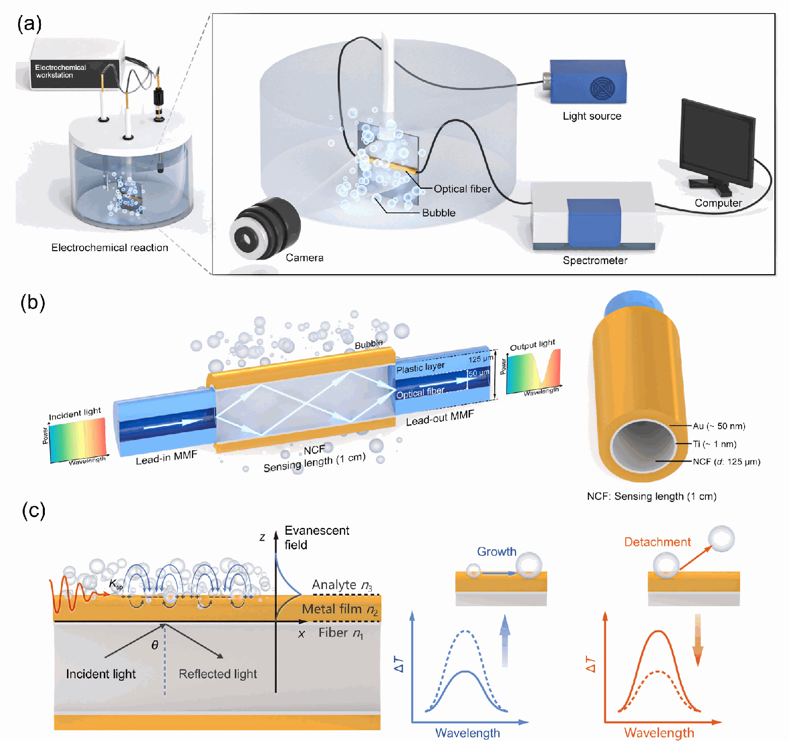

<table>
<tr>
<td width="65%">
<h1>英语阅读策略 · 科普阅读分析</h1>
<p><strong>武汉理工大学《英语阅读策略》课程 · 科普阅读分析</strong></p>
<p>为武汉理工大学《英语阅读策略》课程科普阅读分析活动打造的个人 Codex Skill。<br>从真实论文出发，整理简短中英文科普、原文配图与自然的同学分享回复。</p>
<p><a href="#快速开始">快速开始</a> · <a href="#一份真实定稿">定稿示例</a> · <a href="whut-science-reading/SKILL.md">查看 Skill</a></p>
</td>
<td width="35%"></td>
</tr>
</table>

<p align="center">


</p>

> **少一点术语，多一点“怎样做到”。**
> 不停留在“用了什么技术”，也不堆砌公式和术语：让同学听懂研究人员做了什么、怎样从信号得到信息。

## 可以帮你做什么

| 你现在需要 | Skill 会帮你完成 |
| :--- | :--- |
| 找一篇值得分享的论文 | 推荐真实研究，核对题名、期刊与 DOI，说明科普切入点 |
| 用论文做阅读分享 | 英文短文＋中文概述＋准确出处＋有来源的配图 |
| 原理太笼统或太复杂 | 保留具体步骤与因果过程，按反馈调整详略 |
| 回复同学的分享 | 写 1—2 句具体、自然、可直接粘贴的中文回复 |

## 快速开始

**① 下载** [Skill 安装包 ZIP](docs/english-reading-science-analysis-skill.zip?raw=true)，解压得到 `whut-science-reading` 文件夹。

**② 安装** 将包含 `SKILL.md` 的整个文件夹放入 `~/.codex/skills/`。Windows 通常为 `%USERPROFILE%\.codex\skills\`。

**③ 使用** 在 Codex 新建对话，附上论文并输入：

```text
使用 $whut-science-reading，帮我把这篇论文做成科普阅读分享。
重点讲清怎么检测，少用专业术语，附上中英文正文、出处和配图。
```

<details>
<summary><strong>更多请求：选文、简化与简短回复</strong></summary>

```text
使用 $whut-science-reading，帮我找几篇光纤监测制氢设备的论文，
适合给非本专业同学做阅读分享，给我真实出处与下载入口。
```

```text
使用 $whut-science-reading，这段介绍有点复杂，
请简化语言，但保留“如何检测到信息”的关键过程。
```

```text
使用 $whut-science-reading，这是同学的阅读分享，
帮我写一句简短自然的回复，点出一个具体方法或收获。
```

</details>

## 一份真实定稿

### 一根光纤，怎样感知制氢时的小气泡？

**从“气泡变化”到“光信号”，再到可读懂的信息。**

```text
气泡覆盖光纤 → 光信号增强
气泡脱离光纤 → 光信号减弱
图像与信号对照 → 建立对应关系 → 追踪气泡生长与脱离
```

这一信号方向来自下述研究，不泛化为所有光纤传感器。

<details open>
<summary><strong>English · 用户确认的最终版本</strong></summary>

Can a thin optical fiber tell us how hydrogen bubbles grow and escape? Wei et al. placed a gold-coated optical fiber near an electrode during water electrolysis. As bubbles grow around the fiber, they change how much light passes through it. In this experiment, the light signal rises as bubble coverage increases and falls when bubbles detach. The researchers first compared these signals with camera images to establish a relationship between light intensity and bubble coverage. They could then use the light signals to track bubble growth and detachment and estimate detaching sizes. This method offers a way to study bubbles that can affect hydrogen production efficiency.

</details>

<details open>
<summary><strong>中文 · 简短解释，保留方法</strong></summary>

一根细光纤，怎样知道制氢时的气泡在做什么？研究人员把表面镀金的光纤放在电极附近。气泡逐渐覆盖光纤时，透过光纤的光会增强；气泡脱离后，光信号又会减弱。研究人员先用摄像机记录气泡，把画面与光信号逐一对照，建立两者的对应关系。之后，就能根据光信号的起伏，判断气泡何时生长、何时脱离，并估算脱离时的尺寸，为研究气泡对制氢效率的影响提供帮助。

</details>

<p align="center"></p>

**出处**：Wei, X., Li, J., Liang, W., et al. *Quantifying bubble dynamics via fiber optic sensor for in situ electrocatalytic evaluation*. **Nano Research**, 2025, 18, 94907699. [DOI: 10.26599/NR.2025.94907699](https://doi.org/10.26599/NR.2025.94907699)。

**图片**：原文图1，© The Author(s) 2025，[CC BY 4.0](https://creativecommons.org/licenses/by/4.0/)。英文为科普改写，不是论文原文摘录。

## 默认交付长什么样

| 内容 | 默认尺度 |
| :--- | :--- |
| 英文 | 一段约 90—130 词，问题 → 具体方法 → 信息如何得到 → 发现或用途 |
| 中文 | 一段约 150—230 字，通俗概述同一事实 |
| 来源 | 真实作者、题名、期刊、年份与 DOI 链接 |
| 配图 | 优先原文装置或原理图，附简短图注与来源 |
| 同学回复 | 通常 40—80 字，只给一个可直接使用的版本 |

篇幅是基于个人定稿经验的建议；当次课程要求优先。截止日期、活动周次与评分标准不沿用历史通知。

## 文件导航

```text
whut-science-reading/
├── SKILL.md                      技能入口与工作流程
├── agents/openai.yaml            Codex 显示名称与调用提示
└── references/
    ├── style.md                  写作尺度与回复示例
    └── accepted-example.md       用户确认的完整定稿
```

- [技能指令](whut-science-reading/SKILL.md) · [写作风格](whut-science-reading/references/style.md) · [定稿示例](whut-science-reading/references/accepted-example.md)
- [素材来源与许可](THIRD_PARTY_NOTICES.md)
- `docs/` 保留可在本地打开的配套演示页；本仓库首页即为主要使用入口。

---

<p align="center"><strong>从阅读，到理解，再到分享。</strong><br><sub>个人学习工具，非武汉理工大学官方产品。封面为 AI 生成装饰插画；论文图片保留原始来源。本仓库不附带论文全文、课程私人资料或平台截图。</sub></p>
